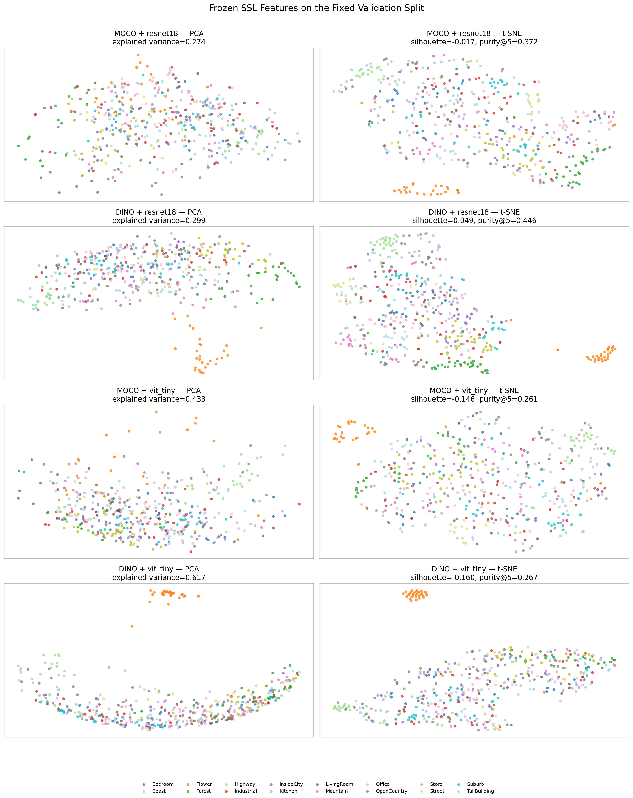

# Assignment 2: Self-Supervised Visual Representation Learning

This repository studies visual representation learning with 2,400 labeled
training images from 16 scene classes. Every model is initialized from scratch
and trained only with the supplied training images. External pretrained weights
and external training images are not used.

## Data

The dataset is deliberately excluded from Git. Place it at:

```text
data/
  train/<class_name>/*.jpg   # 2,400 labeled images
  test/<class_name>/*.jpg    # 400 labeled images; final evaluation only
  test2/*.jpg                # 400 unlabeled images; never used for training
```

The fixed split contains 1,920 training and 480 validation images, balanced
across all 16 classes. Exact SHA-256 duplicate groups are kept entirely within
one partition.

Install the required packages in the selected environment with:

```bash
python -m pip install -r requirements.txt
```

Run the read-only data audit and split tests with:

```bash
python scripts/audit_dataset.py --data-root data
python -m unittest discover -s tests -v
```

To regenerate the fixed split:

```bash
python scripts/create_split.py \
  --data-root data/train \
  --output-dir splits \
  --seed 0 \
  --val-fraction 0.20
```

## Reproducibility policy

- Model selection uses only the fixed validation partition.
- The labeled test set is evaluated only after a method and configuration are
  frozen.
- `test2` is not used for SSL, pseudo-labeling, model selection, or training.
- Each run will save its resolved configuration, seed, history, environment,
  checkpoint checksum, and diagnostic measurements.
- Large model weights will be hosted as a GitHub Release asset or through an
  external checkpoint link.

Training commands and final results will be added as their corresponding
checkpoint milestones are completed. The final two-page report is maintained
outside this repository and submitted separately through Canvas.

## Checkpoint 1: supervised controls

The first controlled comparison trains a randomly initialized ResNet-18 and a
randomly initialized small Vision Transformer. Both use the same fixed split,
224x224 inputs, scene-preserving augmentation, label smoothing, and
validation-only model selection. Their optimizer settings are recorded in the
YAML configurations.

Run both controls sequentially with:

```bash
conda activate vlm_clean
bash run_checkpoint1.sh
```

The runner skips experiments that already have a completed `summary.json`, so
it is safe to resume after one model finishes. Set `FORCE=1` only when an
intentional full retraining is required.

Or run one model at a time:

```bash
python scripts/train_supervised.py \
  --config configs/checkpoint1_resnet18.yaml \
  --device auto

python scripts/train_supervised.py \
  --config configs/checkpoint1_vit_tiny.yaml \
  --device auto
```

These commands do not load or evaluate the labeled test set or `test2`.

The supervised controls produced the following fixed-split results:

| Model | Best validation accuracy | Macro-F1 | Best epoch |
|---|---:|---:|---:|
| ResNet-18 | 83.75% | 83.69% | 53 |
| Tiny ViT | 68.13% | 68.03% | 98 |

## Checkpoint 2: SSL pretraining and downstream evaluation

Checkpoint 2 independently pretrains ResNet-18 and Tiny ViT encoders with
MoCo and DINO-style objectives. All four encoders are randomly initialized and
use only the fixed training partition; external images and pretrained weights
remain prohibited. Each frozen encoder is evaluated with a linear probe, and a
separate copy is fully fine-tuned with a fresh classification head.

Run all four SSL pretraining jobs and eight downstream evaluations with:

```bash
conda activate vlm_clean
bash run_checkpoint2.sh
```

Completed stages are skipped automatically. Interrupted SSL pretraining resumes
from `last.pt`; `FORCE=1` intentionally reruns completed stages. The runner also
creates loss curves, clean-training diagnostics, confusion matrices, and frozen
feature visualizations. Neither test split is loaded.

| SSL method | Backbone | Evaluation | Validation accuracy | Macro-F1 |
|---|---|---|---:|---:|
| DINO | ResNet-18 | Full fine-tune | **83.75%** | **83.80%** |
| MoCo | ResNet-18 | Full fine-tune | 81.88% | 81.75% |
| DINO | ResNet-18 | Linear probe | 72.08% | 71.75% |
| MoCo | ResNet-18 | Linear probe | 67.92% | 67.32% |
| DINO | Tiny ViT | Full fine-tune | 62.92% | 62.66% |
| MoCo | Tiny ViT | Full fine-tune | 62.92% | 62.60% |
| MoCo | Tiny ViT | Linear probe | 50.21% | 49.06% |
| DINO | Tiny ViT | Linear probe | 48.12% | 46.82% |

The strongest frozen representation was DINO–ResNet-18: its five-nearest-
neighbor validation accuracy was 65.83%, compared with 55.42% for
MoCo–ResNet-18. KNN is used only as a no-trained-head representation diagnostic;
it does not affect training or model selection.

The same 480 clean validation images were projected with PCA and t-SNE for all
four frozen encoders. The plots use a consistent class-color mapping and are
accompanied by cosine silhouette, neighborhood-purity, and t-SNE
trustworthiness measurements. DINO–ResNet-18 had the highest silhouette
(0.049) and purity@5 (44.6%), but substantial class overlap remained. Both ViT
representations had negative silhouette scores.



Recreate only the feature analysis with:

```bash
python scripts/visualize_ssl_features.py --device auto
```

Machine-readable summaries are stored under `results/checkpoint2/`, including
`comparison.csv` and
`feature_visualizations/embedding_metrics.csv`. Model weights remain excluded
from Git and can be distributed separately as release assets.

## Checkpoint 3: joint classification and masked reconstruction

Checkpoint 3 studies an MAE-style self-supervised auxiliary task trained jointly
with scene classification. This is a controlled masked-patch reconstruction
objective rather than a claim to reproduce the original full MAE architecture.
The classifier receives a clean augmented image, while the shared encoder also
processes a randomly patch-masked copy for reconstruction. Only masked 16x16
patches contribute to the patch-normalized reconstruction loss. Model selection
uses clean validation classification accuracy only.

A 2x2 factorial comparison varies classification/reconstruction loss weights
and the patch-mask ratio for both backbones:

| Backbone | Classification/MAE weight | Mask ratio | Validation accuracy | Macro-F1 |
|---|---:|---:|---:|---:|
| ResNet-18 | 75/25 | 50% | **79.58%** | **79.31%** |
| ResNet-18 | 50/50 | 50% | **79.58%** | 78.99% |
| ResNet-18 | 75/25 | 75% | 76.67% | 76.09% |
| ResNet-18 | 50/50 | 75% | 74.58% | 73.77% |
| Tiny ViT | 75/25 | 50% | **71.04%** | **70.94%** |
| Tiny ViT | 50/50 | 75% | 68.96% | 68.83% |
| Tiny ViT | 50/50 | 50% | 68.33% | 68.02% |
| Tiny ViT | 75/25 | 75% | 67.29% | 67.27% |

The light 25% reconstruction auxiliary loss with 50% masking improved Tiny ViT
by 2.92 validation-accuracy points relative to its supervised control. No joint
MAE configuration improved ResNet-18. Averaged across loss weights, increasing
masking from 50% to 75% reduced accuracy by 3.96 points for ResNet-18 and 1.56
points for Tiny ViT. These results indicate that the patch-level auxiliary task
was better aligned with the transformer, while aggressive masking and stronger
reconstruction weighting did not improve this small-data setting.

Run the complete sweep with:

```bash
conda activate vlm_clean
bash run_checkpoint3.sh
```

Completed runs are skipped automatically. The runner creates component-loss
curves, classification curves, clean-training diagnostics, confusion matrices,
and `results/checkpoint3/comparison.csv`. Test and test2 are not loaded.

